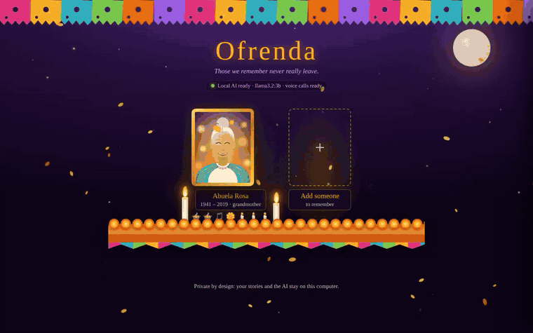
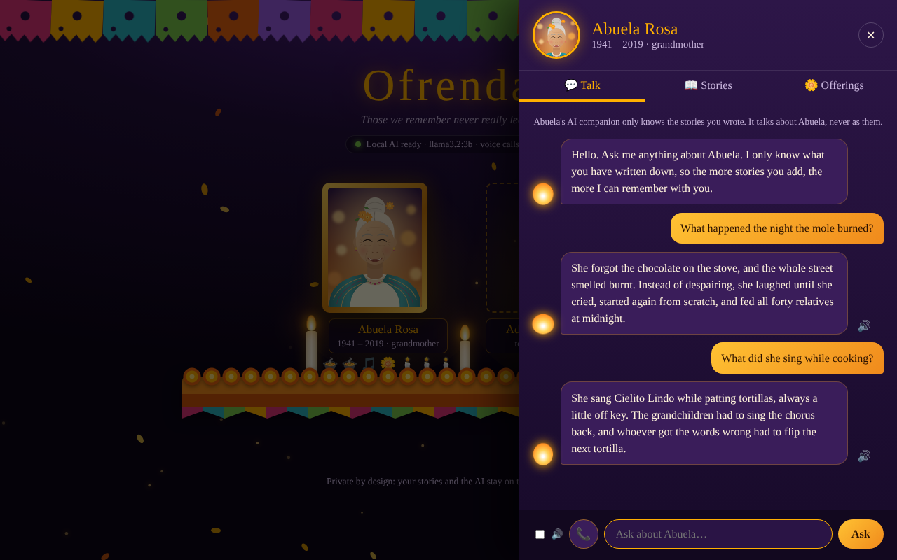
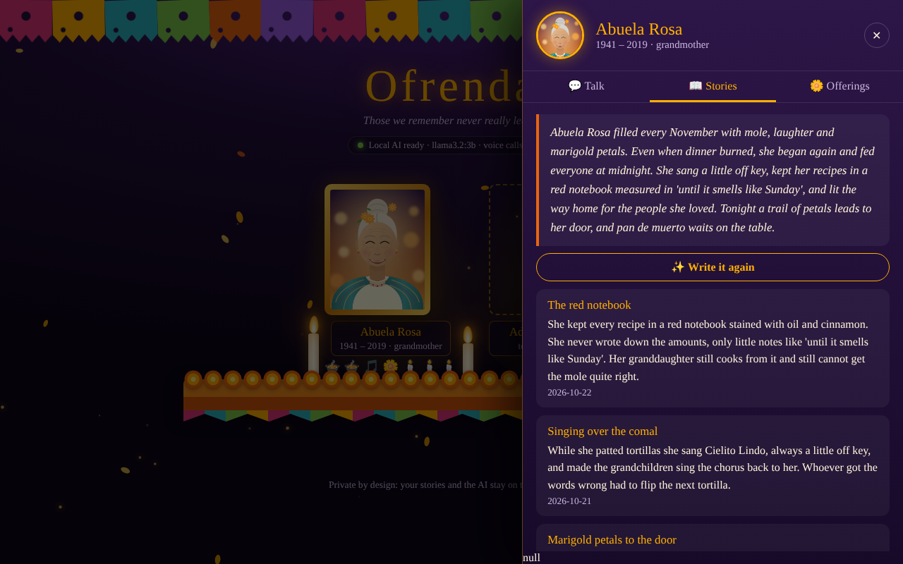
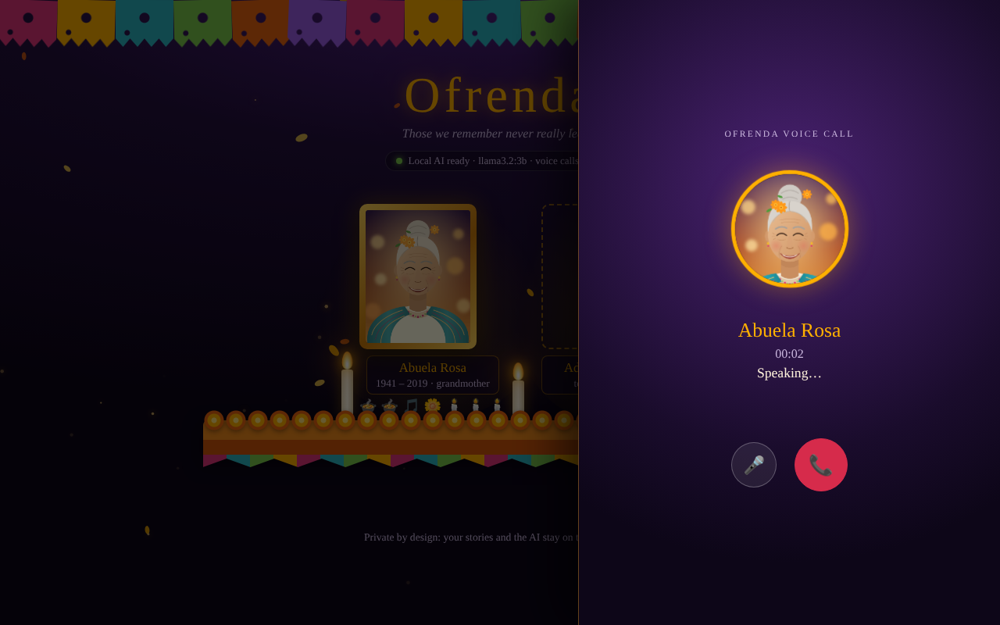
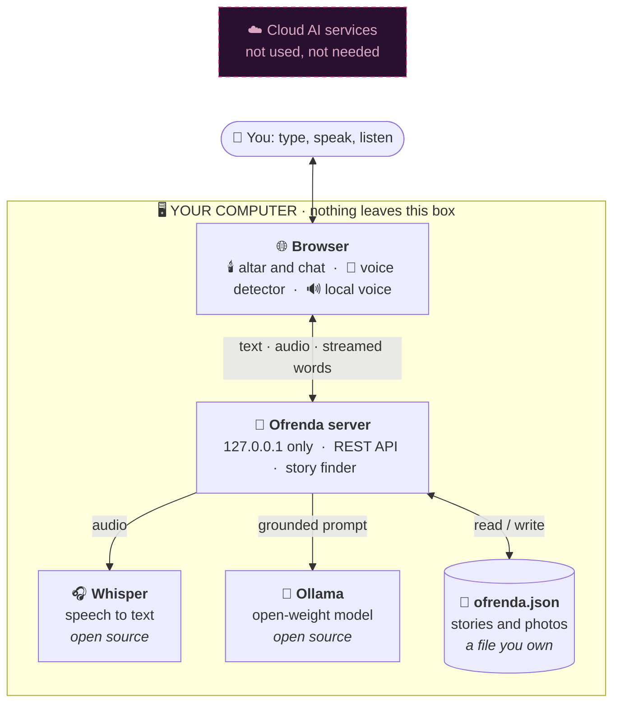
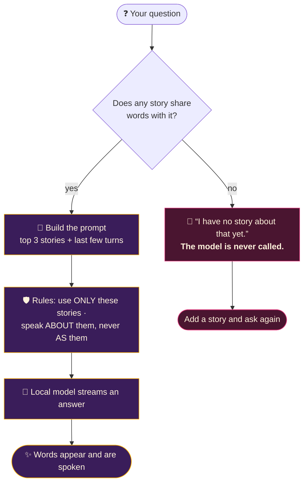
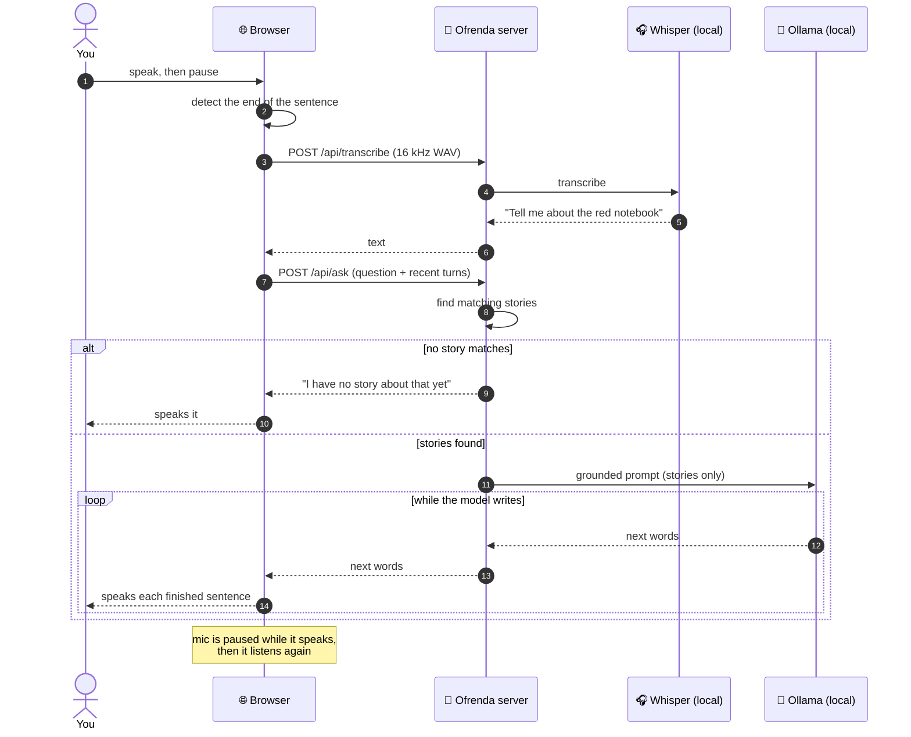
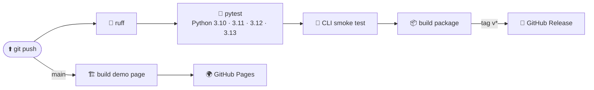

<p align="center">
  
</p>

<p align="center">
  <a href="https://github.com/Hasalawa/ofrenda/actions/workflows/ci.yml"></a>
  
  
  
  
  
</p>

<p align="center">
  <b>A private, candle-lit ofrenda for the people you miss.</b><br>
  Write down their stories, then <i>talk about them</i> with an AI that only knows what you tell it,
  by typing or by a hands-free voice call. Everything runs on your own computer.
</p>

<p align="center">
  <a href="#-quick-start">Quick start</a> ·
  <a href="#-how-it-works">How it works</a> ·
  <a href="#-talk-by-voice">Voice calls</a> ·
  <a href="#-privacy-and-safety">Privacy</a> ·
  <a href="#-why-open-source-ai">Why open source</a>
</p>

> Built for the **Hacktoberfest Open-Source AI Challenge, Week 4: Ghost in the Machine**. The ghost here is
> not a haunting. It is the people who stay with us through the stories we keep.

---

## 🎬 See it

<p align="center">
  
</p>

<table>
  <tr>
    <td width="50%"><br><sub><b>The altar.</b> Papel picado, marigolds, flickering candles, a framed portrait.</sub></td>
    <td width="50%"><br><sub><b>Ask anything.</b> Answers stream in live and come only from the stories you wrote.</sub></td>
  </tr>
  <tr>
    <td width="50%"><br><sub><b>Keep the stories.</b> Add memories, offerings, and write a remembrance.</sub></td>
    <td width="50%"><br><sub><b>Call.</b> Just speak. It listens, thinks, and talks back.</sub></td>
  </tr>
</table>

<sub>Screenshots use the bundled demo data: an illustrated, fictional grandmother. Replies in your own copy come from your own local model, so the wording will differ.</sub>

---

## ✨ What you can do

| | |
|---|---|
| 🕯️ **Build an ofrenda** | Add a person with a photo, their years, and who they were to you. Place their favorite foods, songs and flowers on the altar, and light candles. |
| 📖 **Keep their stories** | Write memories in your own words (or record them and let Whisper write them down). They are saved in one JSON file that you own. |
| 💬 **Talk about them** | Ask "What did she sing while cooking?" The AI answers from your stories only, and streams the reply as it thinks. |
| 📞 **Call** | Press the phone button and talk. A local speech model hears you, a local language model answers, and a local voice reads the reply sentence by sentence. Tap the photo to interrupt. |
| ✍️ **Write a remembrance** | The model turns the stories into a short, warm remembrance for the altar. |
| 🖨️ **Share a page** | Export one self-contained, printable HTML page with the photo and stories inside. |

---

## 🧭 How it works

Everything on this diagram runs on your machine. There is no cloud box, because there is no cloud.



### It never invents a memory

Before the model sees a question, Ofrenda looks for stories that match it. **No match means the model is never called.**
When there is a match, the model gets only those stories, and a rule: speak *about* them, never *as* them.



---

## 🚀 Quick start

You need **Python 3.10+** and **[Ollama](https://ollama.com)**. The core has no other dependencies.

```bash
# 1. get an open-weight model (about 2 GB, once)
ollama pull llama3.2:3b

# 2. get Ofrenda
git clone https://github.com/Hasalawa/ofrenda.git
cd ofrenda
pip install -e .

# 3. light the candles
python -m ofrenda serve                      # opens http://localhost:8765
```

Want to look around first? Open the bundled demo (no data of yours involved):

```bash
python -m ofrenda --data examples/demo.json serve
```

<details>
<summary><b>🪟 Windows tips</b></summary>

- Use `python -m ofrenda ...` instead of `ofrenda ...`. It always works, even if the `ofrenda` command is not on your PATH.
- Start Ollama from the Start menu (a llama icon appears in the tray), then run `ollama list` to check the model is there.
- In PowerShell, keep quotes around names with spaces: `python -m ofrenda add-person "Abuela Rosa"`.

</details>

<details>
<summary><b>⌨️ Prefer the command line?</b></summary>

```bash
python -m ofrenda add-person "Abuela Rosa" --years "1941-2019" --relation grandmother --photo rosa.jpg
python -m ofrenda add-fav    "Abuela Rosa" food "pan de muerto"
python -m ofrenda add-story  "Abuela Rosa" --title "The night the mole burned" --text "She forgot the chocolate..."
python -m ofrenda remember   "Abuela Rosa"                 # write a remembrance
python -m ofrenda ask        "Abuela Rosa" "Why did the mole burn?"
python -m ofrenda build --out ofrenda.html                 # one printable page
```

| Command | What it does |
|---|---|
| `serve [--port N] [--no-open]` | The interactive altar in your browser |
| `add-person NAME [--years] [--relation] [--photo]` | Add someone to the ofrenda |
| `add-story NAME --title T [--text]` | Save a memory (reads stdin if `--text` is omitted) |
| `add-fav NAME food\|song\|flower VALUE` | Place an offering |
| `transcribe NAME AUDIO --title T` | Turn a recorded story into text, offline (needs `[audio]`) |
| `remember NAME [--speak]` | Write a remembrance, optionally read aloud (needs `[voice]`) |
| `ask NAME QUESTION [--speak]` | Ask a question from the terminal |
| `build [--out FILE] [--title T]` | Export a self-contained HTML page |

Use `--data FILE` (or `OFRENDA_DATA`) to keep separate ofrendas in separate files.

</details>

---

## 📞 Talk by voice

```bash
pip install faster-whisper      # open-source Whisper, runs on your computer
python -m ofrenda serve         # then press the 📞 button next to the message box
```

The first call downloads a small speech model (about 150 MB) once. After that it works with no internet.



**For the best call**

- Wear headphones. Otherwise the speakers can leak into the mic and it may answer itself.
- Speak English, in full sentences, then pause for a second.
- Use words that appear in your stories ("notebook", "marigold"). Small talk like "how are you?" has nothing to match, so it gets the "no story" reply.
- Follow-ups work: ask "What happened with the mole?" then "And then?".
- Pick a voice marked as local in the call screen. Voices labelled "(online)" send text to a cloud service.

---

## 🔒 Privacy and safety

| Question | Answer |
|---|---|
| Where are my stories stored? | One JSON file (`ofrenda.json`) and a `photos/` folder, next to where you start the app. |
| Does anything go to the internet? | No. The server listens on `127.0.0.1` only and rejects requests with a foreign `Host` header. The only internet use is the **one-time download** of the models themselves (the Ollama model, and the Whisper model if you use voice). |
| Which AI reads my stories? | The open-weight model *you* run in Ollama. |
| Which AI hears my voice? | Whisper, running on your CPU. Audio is not saved. |
| Can it pretend to be my grandmother? | No. The prompt forbids speaking *as* the person. It talks *about* them. |
| Can it make things up? | It is only given the stories that match your question, and told to say so when they do not answer it. A small model can still slip, so treat it as a companion for memories, not a source of truth. |
| What if Ollama is not running? | The app still works: it falls back to a simple template and shows the matching stories. |

---

## 🌍 Why open-source AI

| | Closed cloud AI | Ofrenda (open weights) |
|---|---|---|
| Your family's stories | Uploaded to someone else's server | Never leave your computer |
| Works with no internet | ❌ | ✅ |
| Still works if a company changes or shuts down a service | ❌ | ✅ you hold the model and the file |
| Swap the model | Whatever they offer | `OFRENDA_MODEL=qwen2.5:7b` or any model Ollama runs |
| Cost per question | Metered | Free after the download |
| Tune it to your family's language | Rarely possible | Possible: open weights can be fine-tuned |

---

## ⚙️ Configuration

| Variable | Default | Meaning |
|---|---|---|
| `OFRENDA_MODEL` | `llama3.2:3b` | Any model Ollama can run. Try `qwen2.5:7b` for richer answers (needs more RAM) or `qwen2.5:1.5b` for a slow laptop. |
| `OLLAMA_HOST` | `http://localhost:11434` | Where your model server lives |
| `OFRENDA_STT_MODEL` | `base.en` | Whisper size: `tiny.en` (fastest), `base.en`, `small.en` (most accurate) |
| `OFRENDA_DATA` | `ofrenda.json` | Where your memories are stored |

Optional extras: `pip install -e ".[audio]"` (Whisper), `".[voice]"` (read-aloud in the terminal), `".[dev]"` (tests and linting).

---

## 🗂️ Project layout

```text
ofrenda/
├─ ofrenda/
│  ├─ cli.py        command line + prompts (the "speak about them, never as them" rules)
│  ├─ web.py        local web server and REST API (127.0.0.1 only)
│  ├─ page.py       the whole interface: altar, chat, voice call (one offline HTML page)
│  ├─ llm.py        talks to Ollama, with streaming
│  ├─ stt.py        speech to text with Whisper (faster-whisper)
│  ├─ retrieve.py   finds the stories that match a question
│  ├─ store.py      the JSON file
│  ├─ render.py     printable, self-contained HTML export
│  └─ voice.py      optional read-aloud for the terminal
├─ tests/           pytest suite for the core, the web API and voice decoding
├─ examples/        demo ofrenda (illustrated portrait + 4 stories)
├─ docs/            banner, diagrams, screenshots, demo GIF
└─ .github/workflows/   CI and GitHub Pages
```

---

## 🧪 Development

```bash
pip install -e ".[dev]"
ruff check .
pytest
```

CI runs on every push, and the demo page is published to GitHub Pages.



To enable the demo page, set **Settings → Pages → Source** to **GitHub Actions** once.

<details>
<summary>🖼️ Diagrams as images (for posts and slides)</summary>

Pre-rendered copies live in [`docs/diagrams/`](docs/diagrams): `architecture.png`, `grounding.png`, `voice-call.png`, `cicd.png`.
Their Mermaid sources (`.mmd`) are next to them.

</details>

---

## 🌼 About the theme

In Mexico, Día de los Muertos (November 1 and 2) is not about fear. Families build an *ofrenda*: photos, candles,
marigolds and the foods their people loved, so the ones who died can find their way home for a night.
Ofrenda keeps that spirit. The "ghost in the machine" is a memory that is looked after, in a machine that is yours.

## License

MIT. See [LICENSE](LICENSE). The portrait in `examples/` is an original illustration of a fictional person.
